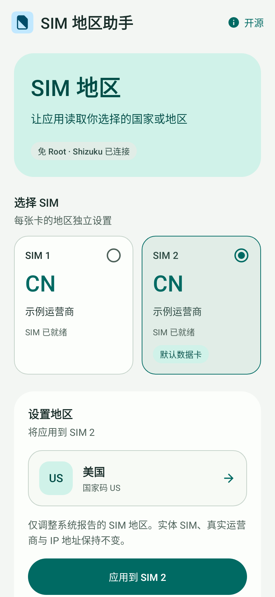
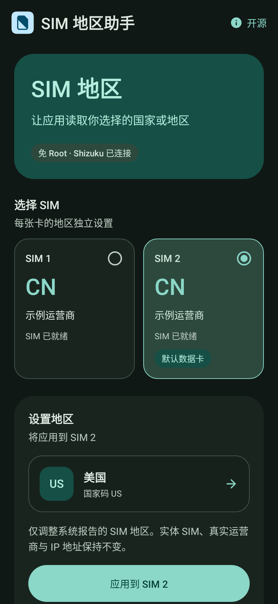
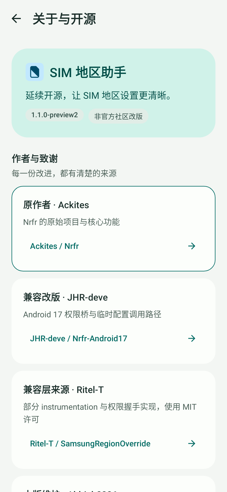
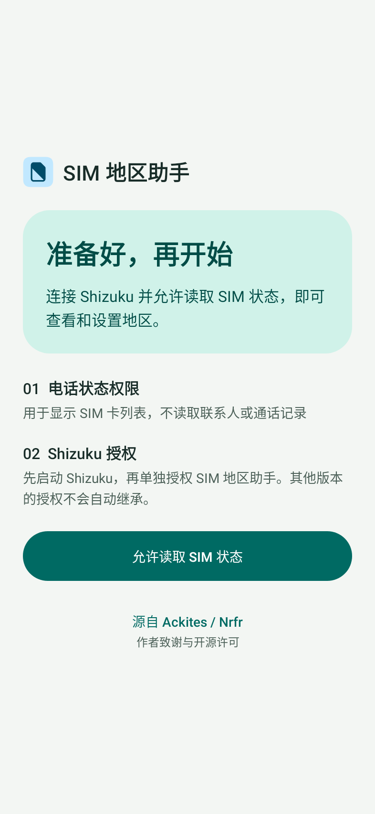

# SIM 地区助手

**一款免 Root 的 SIM 国家码设置工具。** 使用 Shizuku 调整 Android 系统向应用报告的 SIM 国家或地区，提供双卡选择、临时设置、还原和本地环境诊断。

**原作者：[Ackites / Nrfr](https://github.com/Ackites/Nrfr)** · 直接改版来源：[JHR-deve / Nrfr-Android17](https://github.com/JHR-deve/Nrfr-Android17) · 本版维护：[Aldrich2326](https://github.com/Aldrich2326)

SIM 地区助手 是非官方社区改版，保留原作者归属、上游提交历史及开源许可。本版不是任何上游作者的官方发行版，也不代表其认可本版修改。完整来源链见 [作者致谢](CREDITS.md) 和 [修改声明](NOTICE)。

[下载安装包](https://github.com/Aldrich2326/SIM-Region-Helper/releases) · [使用与兼容性](docs/COMPATIBILITY.md) · [构建与验证](docs/RELEASING.md) · [Apache-2.0](LICENSE)

## 界面

浅色与深色主题、清楚的 SIM 选中状态、可搜索的地区选择，以及分开的设置和诊断区域。系统大字体、窄屏与横屏使用可滚动布局，不依赖固定高度容纳正文。

以下为自动渲染的界面预览，使用**虚构 SIM 数据**，不代表某款设备或运营商的实际兼容结果。

| 浅色主题 | 深色主题 |
| --- | --- |
|  |  |

| 作者与来源 | 权限引导 |
| --- | --- |
|  |  |

## 本版改进

- SIM 卡、目标地区、应用操作分层展示；当前地区相同时避免重复写入。
- SIM 未就绪及操作进行时禁用相关操作，显示可读的状态与结果。
- 保留来自直接上游的 instrumentation 权限委托路径，增加 Android 16 状态与广播兼容处理。
- 保存与还原后多次回读，核对国家码与原运营商；未确认稳定生效时报告失败。
- 提供不写入国家码的“检查环境”和用户主动触发的“复制诊断”。
- 主界面和权限页均保留原作入口；关于页提供作者仓库、完整来源和离线许可全文。
- 不需要网络权限，不包含广告或主动上传诊断的功能。

## 开始使用

1. 在 [发行版页面](https://github.com/Aldrich2326/SIM-Region-Helper/releases) 下载已签名 APK。
2. 安装并启动 [Shizuku](https://github.com/RikkaApps/Shizuku)，单独授权 SIM 地区助手。
3. 允许读取电话状态，进入主界面后可先点“检查环境”。该检查不修改国家码。
4. 需要设置时，选择 SIM、目标地区，再点击“应用到 SIM …”。双卡分别处理。
5. 需要撤销时，使用“还原所选 SIM 地区”，并查看回读核验结果。

只调整**系统报告的 SIM 国家码**，不会改变实体 SIM、手机号、真实运营商或 IP 地址。它不是 VPN，也不会自动解锁依赖 IP、GPS、账号地区等条件的功能。配置为临时覆盖，重启、SIM 刷新或系统更新后可能失效。

最低安装版本为 Android 10 / API 29；这不代表所有 Android 10 及以上系统都已兼容。当前版本为预览版，已完成的真机检查范围及未验证项见 [兼容性说明](docs/COMPATIBILITY.md)。

应用显示名称不含手机型号。内部包名暂保留 `io.github.nrfr.iqoo15`，用于延续此前本地测试包的安装升级及还原快照；这不是机型限制。原版和 JHR 改版使用不同包名，其数据与权限不会自动共享。

## 来源与开源

| 项目 | 贡献与许可 |
| --- | --- |
| **[Ackites/Nrfr](https://github.com/Ackites/Nrfr)** | 原始项目与核心功能，Apache-2.0 |
| [JHR-deve/Nrfr-Android17](https://github.com/JHR-deve/Nrfr-Android17) | 直接来源，兼容权限桥与配置调用路径 |
| [Ritel-T/SamsungRegionOverride](https://github.com/Ritel-T/SamsungRegionOverride) | 部分兼容桥与权限握手，MIT |
| [Aldrich2326/SIM-Region-Helper](https://github.com/Aldrich2326/SIM-Region-Helper) | 本版界面、诊断、兼容处理与维护 |

原 [LICENSE](LICENSE) 保持不变；MIT 兼容层版权与许可全文见 [licenses/SamsungRegionOverride-MIT.txt](licenses/SamsungRegionOverride-MIT.txt)。本版修改以 Apache-2.0 提供，已有 MIT 部分维持原许可。[NOTICE-ANDROID17.md](NOTICE-ANDROID17.md) 保留直接上游来源声明；[NOTICE](NOTICE) 记录本版修改。

源码中的 `nrfr-client` 是继承的桌面端参考代码，尚未适配本版，不在 Android APK 的已验证功能内。签名私钥、密码、SDK、构建缓存和手机诊断记录不会上传到仓库。

## 参与维护

遇到问题可在本仓库提交 Issue，说明系统版本、操作步骤和脱敏后的错误；请勿公开手机号、IMSI、ICCID 等信息。构建命令和验证范围见 [发布说明](docs/RELEASING.md)。
